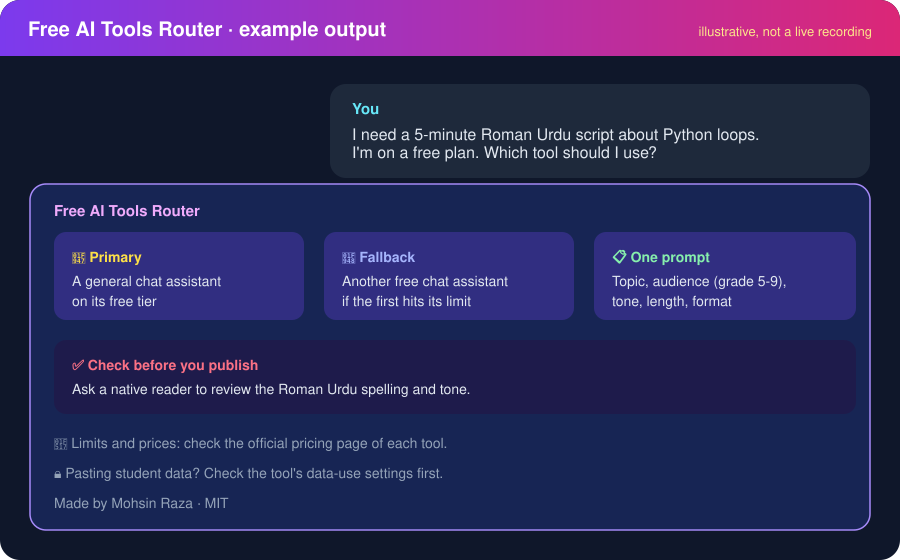
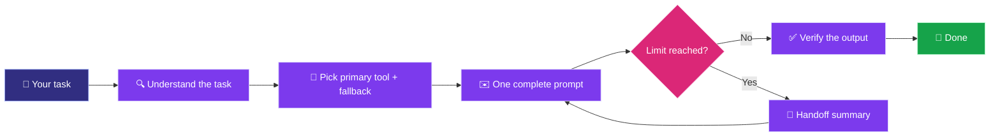
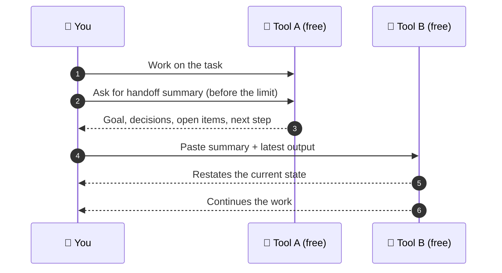

<p align="center">
  
</p>

<h1 align="center">🚀 Free AI Tools Router</h1>

<p align="center">
  <b>Get real value from free AI tiers.</b><br/>
  Pick the right tool, waste fewer messages, and keep your work going when a free limit runs out.
</p>

<p align="center">
  
  
  
  
</p>

<p align="center">
  <a href="https://www.youtube.com/@CodewithMohsin1"></a>
  <a href="https://www.linkedin.com/in/mohsin-raza-a514392b6/"></a>
  <a href="https://www.whatsapp.com/channel/0029VbAREQZDDmFZxWSUQS1o"></a>
</p>

---

## 📖 Table of contents

- [What is this?](#-what-is-this)
- [See it in action](#-see-it-in-action)
- [Who is it for?](#-who-is-it-for)
- [What it does](#-what-it-does)
- [How it works](#-how-it-works)
- [Install](#-install)
- [Use it](#-use-it)
- [Supported tools](#-supported-tools)
- [Honest limits](#-honest-limits)
- [FAQ](#-faq)
- [Contributing](#-contributing)
- [Author](#-author)
- [Changelog](CHANGELOG.md)
- [License](#-license)

---

## 🤔 What is this?

**Free AI Tools Router** is an [Agent Skill](https://agentskills.io) (a folder with a `SKILL.md` file). Once installed, it teaches your AI agent how to:

1. Pick the **right free AI tool** for a task.
2. Write **one complete prompt** so you don't waste messages.
3. **Hand over work** to another tool when a free limit runs out.
4. Point you to the **official page** for current limits, instead of guessing.

It is a set of instructions, not a new AI model and not a detector bypass. Your existing agent does the work.

---

## 🎬 See it in action

<p align="center">
  
</p>

> The image above is an **illustrative example** of the output format, not a live recording.

---

## 👥 Who is it for?

| Who you are | How it helps |
|---|---|
| 🎓 **Students** | Pick the free tool for an assignment, and get a full answer in one message |
| 🎥 **Creators** | Write scripts, captions and posts in English, Roman Urdu or Urdu without waste |
| 💼 **Freelancers** | Draft proposals and client messages, and hand work over when a limit hits |
| 💻 **Developers** | Choose a free coding tool for a project, and move a task to another tool cleanly |
| 🏫 **Teachers** | Plan lessons with a free tool, with a privacy reminder before using student data |

---

## ✨ What it does

| | Feature | What you get |
|:-:|---|---|
| 🧭 | **Tool routing** | One primary pick and one fallback, each with a one-line reason |
| ✍️ | **Efficient prompts** | Full context, audience, format and length in a single message |
| 🔁 | **Clean handoff** | A four-part summary (goal, decisions, open items, next step) to continue elsewhere |
| ✅ | **Verification** | Reminds you to check facts, code and Roman Urdu/Urdu output before using it |
| 🔒 | **Privacy reminder** | Asks you to check data-use settings before pasting student, client or personal data |
| ⚖️ | **Stays in the rules** | Never evades rate limits, never suggests extra accounts, offers legitimate options |

---

## ⚙️ How it works



### 🔁 The handoff, step by step



> 💡 Ask for the summary **before** the limit. If the limit is already hit, copy the chat into a note and write the four parts yourself.

---

## 🚀 Install

Pick the tool you use. Each option below is independent.

### 🟣 Claude.ai (web or desktop app)

**[⬇️ Download free-ai-tools-router.zip](https://github.com/Mohsinraza23/free-ai-stack/raw/main/free-ai-tools-router.zip)**

1. Download the ZIP above. **Do not extract it.**
2. Open [claude.ai](https://claude.ai), go to **Settings**, then **Customize** (or **Skills**, depending on your app version).
3. Click upload and choose `free-ai-tools-router.zip`.
4. Turn the skill on, then test it with: *"Which free AI tool is best for a Roman Urdu script?"*

> ℹ️ Skills need a plan that supports them. If you cannot find the upload option, check your plan first.

### 🟠 Claude Code (terminal or IDE)

```bash
npx skills add Mohsinraza23/free-ai-stack -g
```

Choose `free-ai-tools-router` when asked. Windows manual install: copy the `free-ai-tools-router/` folder into `C:\Users\<you>\.claude\skills\`.

### ⚪ Other agents

```bash
npx skills add Mohsinraza23/free-ai-stack
```

The installer lists every supported agent it finds on your machine, such as Cursor, Codex and Antigravity.

### 🔄 Update or remove

```bash
npx skills update
npx skills remove free-ai-tools-router
```

<details>
<summary>📂 <b>What's in the repo?</b></summary>

```text
free-ai-stack/
├── README.md                      ← you are here
├── LICENSE                        ← MIT
├── CONTRIBUTING.md                ← how to contribute
├── CHANGELOG.md                   ← version history
├── scripts/
│   └── check_links.py             ← checks README links
├── free-ai-tools-router.zip       ← upload this to Claude.ai
├── assets/
│   ├── banner.svg                 ← banner image
│   └── demo.svg                   ← example output
└── free-ai-tools-router/
    └── SKILL.md                   ← the skill itself
```

</details>

---

## 🎯 Use it

| You want to... | Example request |
|---|---|
| 🧭 Choose a free tool | *"Which free AI should I use to write a YouTube script in Roman Urdu?"* |
| ✍️ Save messages | *"Help me write one prompt that gets the full blog post, not a draft."* |
| 🔁 Continue after a limit | *"I hit my free limit mid-project. Make a handoff summary for another tool."* |
| 🔍 Check a free feature | *"Is the free plan of this tool still good for coding?"* |

### Example

**You:** I need a 5-minute Roman Urdu script about Python loops. I'm on a free plan.

**Skill output:**
- 🥇 **Primary:** A general chat assistant on the free tier, since this is a single writing task.
- 🥈 **Fallback:** Another free chat assistant if the first hits its limit.
- 📋 **Prompt:** One message with topic, audience (grade 5-9 students), tone, length, and format.
- ✅ **Check:** Have a native reader review the Roman Urdu spelling before publishing.

---

## 🧰 Supported tools

The skill covers these free tiers. Limits change often, so always confirm on the official page.

> 🔎 **Link status:** Links were added on 2026-11-04. An automated check has not been run yet. Run `python3 scripts/check_links.py` to check them.

| Tool | Best for | Official page |
|---|---|---|
| 🟠 Claude | Long writing, reasoning, analysis | [claude.com/pricing](https://claude.com/pricing) |
| 🟢 ChatGPT | General chat, writing, research | [openai.com/chatgpt/pricing](https://openai.com/chatgpt/pricing/) |
| 🔵 Gemini | Google ecosystem, quick tasks | [gemini.google.com](https://gemini.google.com) |
| 🟣 Google Antigravity | Agentic coding in an IDE | [antigravity.google/docs/plans](https://antigravity.google/docs/plans) |
| ⚫ Cursor | Coding in a project folder | [cursor.com/pricing](https://cursor.com/pricing) |
| 🔴 Qwen | Chat and multilingual tasks | [chat.qwen.ai](https://chat.qwen.ai) |

---

## ⚠️ Honest limits

- 📉 **Free limits change often.** This skill stores no numbers. It tells you where to check them.
- 🚫 **No rate-limit evasion.** It does not create extra accounts or share accounts. Those break provider terms.
- 🧪 **Recommendations are based on task fit.** Always test on your own work.
- 🔐 **Privacy first.** Check each tool's data-use settings before pasting personal, student or client data.

---

## ❓ FAQ

<details>
<summary><b>Does it work with every AI agent?</b></summary>

It works with any agent that supports the Agent Skills `SKILL.md` format, such as Claude Code, Codex, Cursor and others. Some chat-only apps cannot load skills, so use them through an agent that can.

</details>

<details>
<summary><b>Does it store my data or my account?</b></summary>

No. It is a set of text instructions. It does not log in to your accounts or read your usage.

</details>

<details>
<summary><b>Will it tell me how many messages I have left?</b></summary>

No, on purpose. The live number is on each tool's own usage or settings page. The skill points you there.

</details>

<details>
<summary><b>Is it free?</b></summary>

Yes. The skill is MIT licensed. The tools it routes you to have their own pricing, which you can check on their official pages.

</details>

---

## 🤝 Contributing

Read [CONTRIBUTING.md](CONTRIBUTING.md) first. Issues and pull requests are welcome, especially for:

- 🔄 Corrections when a provider changes its free plan
- 🧩 Better prompt templates for specific tasks
- 🇵🇰 Roman Urdu and Urdu examples

---

## 👨‍💻 Author

**Mohsin Raza**, AI engineer and educator from Pakistan. I teach AI and coding on my channel.

<p>
  <a href="https://www.youtube.com/@CodewithMohsin1"></a>
  <a href="https://www.linkedin.com/in/mohsin-raza-a514392b6/"></a>
  <a href="https://www.whatsapp.com/channel/0029VbAREQZDDmFZxWSUQS1o"></a>
  <a href="https://www.instagram.com/mohsinraza3541/"></a>
  <a href="https://www.facebook.com/mohsin.raza.166438"></a>
  <a href="https://codewithmohsin-links.vercel.app/"></a>
</p>

---

## 📄 License

Released under the [MIT License](LICENSE).

<p align="center">
  <sub>⭐ If this helped you, a star on the repo means a lot.</sub>
</p>
